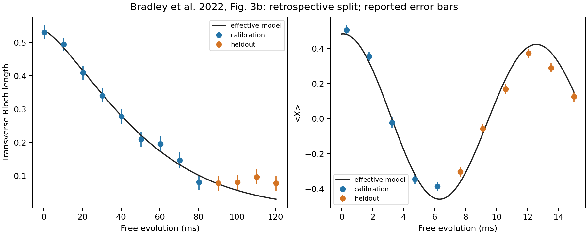

# Andra experimentjämförelsen: C-13-minne i diamant med NV0

Experimentjämförelsen är genomförd och reproducerbar. Den kalibrerade modellen klarar diagnostiken för den uppmätta koherensen, men inte för den signerade Ramseyoscillationen. Fallet ger därför **inte** en godkänd mikroskopisk fysikvalidering eller tillåtelse till nätverksexport. Inga nya laboratoriemätningar har utförts.

Underlaget är Bradley et al., *Robust quantum-network memory based on spin qubits in isotopically engineered diamond*, npj Quantum Information 8, 122 (2022), [artikel](https://doi.org/10.1038/s41534-022-00637-w), [öppna data, version 3](https://doi.org/10.4121/16887658.v3). Vi använder figur 3b och dess inset; en separat NMR-mätning i figur 3a bestämmer modellens frekvens. Detta är ett experimentellt förankrat fall inom defektspinn, som kompletterar projektets Pr:YSO-fall.

## Granskade data och betingelser

Originalarkivet och analysnotebooken har kontrollerats mot källan. Arkivets publicerade MD5 är `0e1fb4500688659f9dcca3123831e4f3`. Körningen verifierar SHA256 och att de extraherade filerna verkligen finns med identiska bytes i arkivet. Datasetets licens är CC BY 4.0. Källans färdiganpassade kurvor används inte som mätvärden.

| Egenskap | Experiment och modellomfattning |
|---|---|
| Lagringssystem | Ett C-13-kärnspinn, I = 1/2, nära ett NV-centrum i diamant |
| Temperatur | 4 K |
| Magnetfält | (Bx, By, Bz) = (0,3 ± 0,1; 0,06 ± 0,08; 46,801 ± 0,001) G; z längs NV-axeln |
| Isotopsammansättning | Typ IIa CVD-diamant, målsammansättning 0,01 % C-13; ingen atomvis badkonfiguration identifierad |
| Lagring | Fri Ramseyutveckling i heraldad NV0; inga refokuseringspulser |
| Laddningsbyte | Joniserings- och återladdningspulser på 1 ms för detta protokoll; NV− postselekteras efter återladdning |
| Mätstorheter | 13 punkter för sqrt(X² + Y²), 11 separata punkter för X |
| Felstaplar | Källans rapporterade fel används oförändrade som diagnostiska skalor |
| SPAM | Kärnspinnsdata är inte korrigerade för tillståndsberedning och avläsning |

Alla tider konverteras från ms till s. Vi lägger inte till en artificiell nollpunkt, normaliserar inte signalen till ett och klipper inte brusiga mätvärden. Koherenslängden och X har separata signalamplituder eftersom de är separata mätserier. Den positiva Bloch-längden kan ha en brusrelaterad bottennivå; den modellen ingår inte i denna analys.

Granskningen är en käll- och modellgranskning i samband med implementationen. En oberoende kollegas vetenskapliga granskning återstår.

## Hamiltonian och effektiv koherensmodell

En villkorlig kärnspinn-Hamiltonian som beskriver den fysikaliska kontexten är

\[
H/h = \nu_L I_z + m_s(A_\parallel I_z + A_\perp I_x).
\]

Artikeln rapporterar A_parallel = 80 ± 1 Hz och A_perp = 271 ± 4 Hz, mätta i NV−. Att överföra samma tensor till NV0 är ett antagande som inte är oberoende fastställt. Vi använder därför inte dessa värden till en parameterfri prediktion av hela koherenskurvan. Artikeln härleder dessutom NV0:s elektronrelaxation ur samma koherensmätning; den kan inte behandlas som en separat validerande mätning.

Det körda fallet använder i stället en uttryckligt **effektiv** Hamiltonian i roterande referenssystem:

\[
H_{\mathrm{eff}}/h = \Delta\nu I_z,\qquad I_z=\mathrm{diag}(1/2,-1/2).
\]

Den separata NMR-mätningen ger 50 229,8 ± 0,1 Hz. Med RF-referensen 50 150 Hz blir Δν = 79,8 Hz. Referensen motsvarar den publicerade artificiella detuningen 80 Hz relativt 50 230 Hz; motsatt teckenkonvention ger samma X-modell efter motsvarande byte av faskonvention. Frekvensen anpassas inte till Ramseyseriens undanhållna punkter.

Dämpningen är E(t) = exp[−(t/τ)^β]. Vi jämför direkt

\[
\sqrt{X^2+Y^2}_{\mathrm{modell}}=A E(t),\qquad
X_{\mathrm{modell}}=E(t)[c\cos(2\pi\Delta\nu t)+s\sin(2\pi\Delta\nu t)].
\]

Den effektiva kvantkanalen består av denna z-rotation och en defasningskanal med Krausoperatorerna sqrt((1+E)/2) U och sqrt((1−E)/2) U Z. Signalens A, c och s tillhör mätmodellen och ingår inte som kanaldämpning. Oberoende matrisexponentiering verifierar rotationen och dämpningen; tester kontrollerar spårbevarande och positiva tillstånd. Dessa numeriska kontroller bevisar inte att modellen är experimentets unika fysikaliska mekanism.

## Kalibrering, undanhållna punkter och resultat

För koherenslängden kalibreras A, τ och β mot de första 9 punkterna, till och med 80,3 ms. De sista 4 punkterna, 90,3–120,3 ms, hålls utanför anpassningen. För X kalibreras endast c och s mot de första 5 punkterna, till och med 6,18 ms; de sista 6 punkterna hålls utanför. X använder τ och β från koherenskalibreringen.

Uppdelningen valdes efter att datasetet hade inspekterats. Den är retrospektiv och inte förregistrerad. Mätpunkter hålls utanför själva anpassningen, men detta är inte ett nytt oberoende experiment. Ingen slumpmässig sampling eller seed behövs för den deterministiska anpassningen.

Anpassningen ger A = 0,53533, τ = **55,25 ms**, β = **1,36263**, c = 0,48286 och s = 0,02318. τ är en effektiv skala från den valda delmängden; inget nytt fysikaliskt T2-värde med konfidensintervall har fastställts. Artikelns anpassning till hela koherensserien rapporterar 57 ± 3 ms och β = 1,2 ± 0,1.

Den valda diagnostiken kräver att största absoluta residualen på undanhållna punkter, dividerad med källans felstapel, är högst 3.

| Jämförelse | Kalibrering / undanhållna | Största skalade residual | Utfall |
|---|---:|---:|---|
| Koherenslängd | 9 / 4 | 2,428 | Klarar diagnostiken |
| Ramsey X, fast 79,8 Hz | 5 / 6 | 3,158 | Klarar inte diagnostiken |
| Frekvenskänslighet 79,7 / 79,9 Hz | Samma uppdelning | 3,209 / 3,107 | Avvikelsen kvarstår |

Gränsen ändras inte efter utfallet. Diagnostiken omfattar inte osäkerheten från kalibreringen, korrelationer mellan mätpunkter eller en likelihood för råa mätutfall. Den är därför inte ett signifikanstest och avvikelsen visar inte att den publicerade experimenttolkningen är felaktig.



## Reproduktion och kontroller

Från projektroten, i en separat Python 3.12-miljö:

```bash
python3.12 -m venv .venv-bradley
source .venv-bradley/bin/activate
python -m pip install -r evaluation/data/bradley2022_nv0/requirements-tested.txt -e ./lab
python scripts/evaluate_bradley_nv0.py --out reproductions/bradley-nv0 --plot
python -m unittest discover -s evaluation/tests -v
python -m unittest discover -s lab/tests -v
```

Analysen behöver ingen nätverksanslutning efter installation. **Returkod 2 är det förväntade resultatet**, eftersom X-diagnostiken inte klaras; både sammanfattning och punktvis CSV skrivs ändå. Ett återanvänt, icke-tomt outputbibliotek avvisas.

Den behållna körningen och en omkörning med sockets och DNS blockerade gav exakt samma vetenskapliga sammanfattning och punktvisa CSV. En tredje körning skapade den slutliga figuren. Detta är reproduktion på samma maskin, inte kollegial reproduktion i en annan miljö. Miljön använder Python 3.12.14, NumPy 2.3.5, SciPy 1.16.3 och Matplotlib 3.10.8; tidigare körningsmiljöer i projektet behåller sina egna versionsposter.

De två testsamlingarna omfattade 98 tester: **91 passerade, 7 hoppades över** på grund av frånvarande valfria beroenden. Fem nya tester omfattar verkliga data, undanhållna punkters oberoende från kalibreringen, oberoende Hamiltonianberäkning, källintegritet/betingelser/evidens och kontroll av antal punkter. Loggar och offlinebekräftelse finns i `evidence/bradley2022/`.

## Vad fallet avslutar och vad som återstår

Vi har nu en körd andra experimentjämförelse med spårbara koherensdata, explicit Hamiltonian, dokumenterade experimentbetingelser, separerad kalibrering och kontroll samt ett sparat negativt delresultat.

Den ursprungliga strikta step-2-uppgiften är fortfarande öppen: datasetet ger inte full komplex, normaliserad ren defasning med separerad populationsrelaxation, ett oberoende fastställt mikroskopiskt brusförlopp eller en granskad optisk skriv/läskanal. Därför behålls `physical_validation_passed=false`, `microscopic_model_validated=false` och `network_exported=false`, och den tidigare blockerade step-2-konfigurationen ändras inte. Nästa fysikaliska beslut kräver oberoende NV0-Hamiltonian/bruskalibrering, kompletterande mätningar och kollegial granskning.
