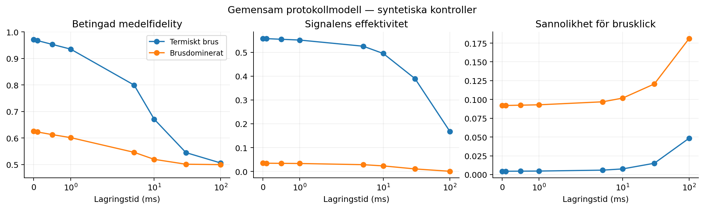
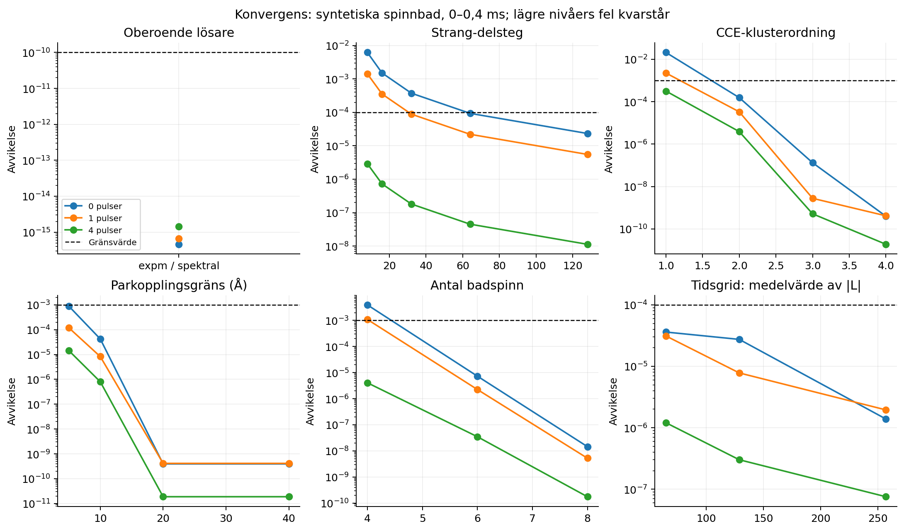
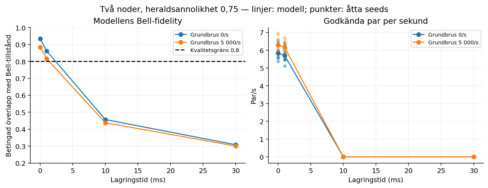

# Gemensam protokollvalidering, spinnbadskonvergens och två nätverkssimulatorer

**Utfört 10 oktober 2026.** Detta är ett nytt körbart resultatpaket efter det granskade Bradley-fallet. De tidigare manuskriptens resultat är egna historiska snapshots; deras PDF-filer har inte skrivits om med dessa nya resultat.

## Vad som är färdigt

| Begärt steg | Utfört arbete | Resultat och gräns |
|---|---|---|
| Fidelity, effektivitet och brus över tid | Komplett effektiv modell för skrivning, lagring, läsning och detektion; oberoende matrisreferens | 56 kanal–tidspunkter och 336 tillståndsprober godkända numeriskt. Gemensam experimentell validering är fortfarande **inkonklusiv**. |
| Konvergens före större spinnbad | Sex numeriska kontroller, 69 koherensberäkningar och 66 diagnostikrader | Slutnivåerna godkända för de specificerade syntetiska baden, 0–0,4 ms. Ingen materialprediktion godkänd. |
| Andra simulatorn och större studier | SeQUeNCe 1.2.0 och QuNetSim 0.1.2 med gemensamma slumptalsserier | Pilot: 96 körningar. Därefter 256 körningar och 131 072 försök; alla 128 parade jämförelser godkända. |

Det handlar om lokal programvaru- och modellverifiering. Antalet nya hårdvaruexperiment är **noll**. Studierna är inte prospektivt förregistrerade och visar inte överlägsenhet gentemot andra material eller simulatorer.

## 1. Ett sammanhängande minnesprotokoll

`memorylab.protocol` lägger ett uttryckligt detektionsinstrument ovanpå minneskanalen. Skriv- och läsförluster, depolarisering, relaxation, dekoherens och lagringsförlust följer samma tidskonventioner som den befintliga modellen. Det separata läsbruset har ett namngivet ursprung; ett ursprung som redan finns i kanalens brusbudget avvisas för att undvika dubbelräkning.

Instrumentet använder en avgränsad modell för det första accepterade klicket: en återhämtad signal har företräde; bakgrund kan accepteras om signalåterhämtningen misslyckades. Med signalåterhämtning \(\eta(t)\), bakgrundsintensitet \(r(t)=r_0+at\) och detektionsfönster \(\Delta\) gäller

\[
 b(t)=1-e^{-r(t)\Delta},\qquad q(t)=[1-\eta(t)]b(t),\qquad p_{\mathrm{acc}}(t)=\eta(t)+q(t).
\]

Här är \(q\) sannolikheten för ett accepterat brusklick per försök. Den ska inte förväxlas med signalens effektivitet. För de sex rena Pauli-tillstånden har den fasta bakgrundsberedningen medelfidelity 1/2, vilket ger

\[
 F_{\mathrm{det}}(t)=\frac{\eta(t)F_{\mathrm{signal}}(t)+q(t)/2}{\eta(t)+q(t)}.
\]

Vid noll accepterade händelser redovisas betingad fidelity som saknad, inte som ett framgångsrikt minne. Dubbelklick, flerfotontillstånd och tillståndsberoende effektivitet ligger utanför instrumentets giltighet.

Sju kontroller omfattar identitet, full förlust, enbart bakgrund, dephasing med förlust, termiskt brus, polariserad bakgrund och ett brusdominerat fall. Vid åtta lagringstider från 0 till 100 ms jämförs full Choi-matris, sex utgående tillstånd, fidelity och sannolikheter mot en separat Liouvillian- och matrisenhetsimplementation. CP och TP kontrolleras också. Största numeriska avvikelsen var **1,4433 × 10⁻¹⁵**, mot gränsen 10⁻¹⁰.



### Varför experimentdelen fortfarande är öppen

De oförändrade mätbytes som redan ingår i projektet granskades på nytt. PR2026-underlaget har nio gemensamma tidspunkter för effektivitet, brus och signal–idler-korrelation \(g^{(2)}\), totalt 27 centrala skalärvärden med tillhörande fel. Det innehåller ingen matchande serie av qubit-fidelity. Korrelationen ersätter därför inte fidelity. Källdatans och artikelns tidsskalor skiljer dessutom med 0,9 µs, och brus per herald kan inte utan vidare användas som bakgrundssannolikhet per vakuumförsök.

Tellers optiska fidelitypunkt identifierar inte en tidskurva. Bradleys granskade NV⁰-koherenskurva har inte motsvarande optiska effektivitets- och brusserier. Att kombinera dem skulle skapa en experimentbetingelse som inte mätts.

`selected/protocol/experimental_audit.json` bevarar mätvärdena och luckorna. `experimental_pending.json` anger vad som behövs: tomografi eller tillståndsräkningar, återhämtningsräkningar och bakgrundskontroller vid samma tider, med gemensamma nämnare, heralddefinition, detektionsfönster, temperatur, fält, pulser och skriv-/läsprotokoll. Osäkerheter, kovarians och kalibrerings-/holdoutuppdelning måste också anges. Ingen experimentell helhetsgate har passerat.

## 2. Konvergens innan badet utökas

Studien använder ett nästlat, syntetiskt och icke-kommuterande ¹³C-bad, maximalt blandat initialtillstånd och idealiska CPMG-pulser: 0, 1 eller 4 pulser. Hamiltonianerna anges i Hz och propagatorn använder \(2\pi\):

\[
 H_m/h=\sum_i\boldsymbol\nu_i\!\cdot\!\mathbf I_i+
 \sum_{i<j}\mathbf I_i\!\cdot\!J_{ij}\!\cdot\!\mathbf I_j+
 m\sum_i\mathbf A_{i,z}\!\cdot\!\mathbf I_i,\qquad m=\pm\tfrac12.
\]

Koherensen beräknas från de två betingade propagatorerna. Hyperfin- och parkopplingarna har avsiktligt svaga yttre bidrag. Detta är ingen materialspecifik gittermodell eller experimentellt bestämd badfördelning.

| Kontroll | Nivåer | Största avvikelse vid slutnivån | Gräns |
|---|---|---:|---:|
| Oberoende exakt lösare | Matrisexponential mot spektral propagation | 1,4436 × 10⁻¹⁵ | 10⁻¹⁰ |
| Propagationsupplösning | 8, 16, 32, 64, 128 Strang-delsteg | 2,3320 × 10⁻⁵ | 10⁻⁴ |
| CCE-klusterordning | 1, 2, 3, 4 på fyrspinnsreferensen | 4,1316 × 10⁻¹⁰ | 10⁻³ |
| Gräns för parkoppling | 5, 10, 20, 40 Å | 4,1316 × 10⁻¹⁰ mot exakt referens | 10⁻³ |
| Badstorlek | 2, 4, 6, 8 spinn | 1,4517 × 10⁻⁸, skillnaden 6 → 8 | 10⁻³ |
| Tidsgrid | 33, 65, 129, 257 punkter | 1,9496 × 10⁻⁶, medelvärdet av \(|L|\) | 10⁻⁴ |

Lägre upplösningars misslyckade rader finns kvar i `convergence.csv`. Tidsgridkontrollen gäller integrationen av medelkoherensen; den bevisar inte upplösning av samtliga återväckelser eller konvergens av ett experimentellt T₂. Strang-kontrollen gäller numerisk propagation mellan idealiska pulser och validerar inte pulsform eller pulsfel.

Ett fel i PyCCE-adaptern rättades: uttryckligen angivna parkopplingstensorer förs nu vidare till PyCCE. Alla par i kontrollbadet anges, eftersom PyCCE annars kan fylla frånvarande par med dipolkopplingar. Zeemanvärdenas tecken och enheter jämförs uttryckligen mellan de två implementationerna.



För profiler med `prediction_purpose: material_prediction` kräver `convergence_guard` ett godkänt underlag vars hash matchar hela profilen, samtliga fem konvergensaxlar, godtagbart fel, ett giltigt tidsintervall och fysisk modellgranskning. Hypotetiska data kan inte ge materialgodkännande. Det är en kontroll av deklarerat underlag; den ersätter inte en mänsklig vetenskaplig granskning. Äldre profiler utan denna ändamålsdeklaration fungerar fortsatt, men får inget nytt materialgodkännande genom denna studie.

## 3. Två faktiska simulatorstackar och en större studie

SeQUeNCe kör sin händelsekö och densitetsmatrishanterare. QuNetSim kör sina egna värdar, kvantförbindelser, paketköer och ACK-flöden. QuNetSim-adaptern har en ny, protokollspecifik QuTiP-backend för densitetsmatriser; det är inte en körning med dess standardbackend EQSN. Den bevarar gemensamma tillstånd, överför en Bell-halva mellan värdar och förbrukar båda qubitarna efter läsningen.

De två stackarna får samma externa logiska tidslinje och separata, reproducerbara slumptalsströmmar för heraldning och de två läsningarna. Identiska utfall är därmed en kontroll av implementationerna under parade ingångar, inte två oberoende experiment. QuNetSims verkliga trådschemaläggning jämställs inte med fysisk nätverkstid. Varje studie kör i en ny process för att undvika omstart av dess globala nätverksinstans.

Den valda studien har 16 parameterkombinationer: två grundbrusnivåer (0 och 5 000/s), fyra lagringstider (0, 1, 10 och 30 ms) och två heraldsannolikheter (0,25 och 0,75). Försöksintervallet är 40 ms och modellens kvalitetsgräns Bell-fidelity 0,8. Kvalificerad parhastighet bestäms från modellens ensemblefidelity, inte från dolda signal-/brusetiketter för enskilda försök.

| Studie | Seeds | Parade fall | Simulatorkörningar | Försök per körning | Försök i båda simulatorerna |
|---|---|---:|---:|---:|---:|
| Pilot | 1101–1103 | 48 | 96 | 32 | 3 072 |
| Större studie | 2101–2108 | 128 | 256 | 512 | 131 072 |
| Totalt | 11 | 176 | 352 | — | 134 144 |

Den större studien startade efter godkända protokoll-, konvergens- och pilotkontroller. Alla 256 körningar lyckades. Alla 128 parade fall gav identiska grenräkningar och logiska tidslinjer. Största skillnaden mellan medeltäthetsmatriserna var **2,4651 × 10⁻¹⁵**. SeQUeNCe utförde 98 344 händelser; QuNetSim utförde 32 808 kvantpaketöverföringar.

Åtta seeds är åtta oberoende slumptalskluster per parameterkombination, inte 131 072 oberoende forskningsresultat. Figuren visar samtliga seedutfall och modellens förväntan; inga konfidensintervall, effektstorlekar eller hastighetsfördelar hävdas. Försöken är avgränsade till två noder och en minnesplats. Routing, swapping, kökonkurrens, realistisk fiberfördröjning och stora nätverk har inte validerats.



## Kontroll mot befintliga verktyg och källor

| Etablerat verktyg | Användning här | Vad resultaten tillför projektet |
|---|---|---|
| [PyCCE, officiell dokumentation](https://pycce.readthedocs.io/en/latest/), [metodartikel](https://doi.org/10.1002/adts.202100254) | CCE-beräkningar med specificerade Hamiltonianer | En reproducerbar jämförelse mot exakt liten-bad-referens och kvarvarande negativa konvergensdiagnostiker |
| [SeQUeNCe, officiellt repository](https://github.com/sequence-toolbox/SeQUeNCe) | Händelser och gemensamma densitetsmatriser | Fullt protokollinstrument kopplat till den befintliga nätverksstacken |
| [QuNetSim, officiellt repository](https://github.com/tqsd/QuNetSim), [metodartikel](https://doi.org/10.1109/TQE.2021.3092395) | Native värdar och kvanttransport med egen QuTiP-backend | En andra körd stack med parade tillstånds- och utfallskontroller |

Ingen ny CCE-metod eller generell nätverkssimulator introduceras. Bidraget är projektets sammanhängande, granskningsbara valideringskedja. Experimentgranskningens bytekälla är [PR2026-data](https://doi.org/10.5281/zenodo.21532904), kopplad till [artikeln](https://doi.org/10.1103/ftkb-pkvp); licens, ursprung och kontrollsummor finns i projektets befintliga datamanifest.

## Reproduktion och verifiering

Den testade miljön är Linux, Python 3.12.14, NumPy 2.3.5, SciPy 1.16.3, PyCCE 1.1.1, QuTiP 5.3.1, SeQUeNCe 1.2.0 och QuNetSim 0.1.2. `requirements-tested.txt` är en fullständig versionssnapshot av den körda miljön. Kör i en separat miljö från äldre artikelberoenden:

```bash
python3.12 -m venv .venv-extension
source .venv-extension/bin/activate
python -m pip install -r evaluation/config/validation_extension/requirements-tested.txt -e ./lab
export OMP_NUM_THREADS=1 OPENBLAS_NUM_THREADS=1 MKL_NUM_THREADS=1
export WQ_BLOCK_EXTERNAL_NETWORK=1
export PYTHONPATH="$PWD/scripts/network_guard:$PWD/lab"
python scripts/run_validation_extension.py --count
python scripts/run_validation_extension.py --out reproductions/my-extension
python scripts/verify_validation_extension.py \
  --reference evaluation/results/validation_extension/selected \
  --actual reproductions/my-extension --out reproductions/my-extension/verification.json
python scripts/plot_validation_extension.py
python -m unittest discover -s lab/tests -v
python -m unittest discover -s evaluation/tests -v
```

`--resume` återanvänder endast checkpoints med matchande konfigurations- och källkodshashar. En färsk offlinekörning har redan genomförts: **359 JSON-poster och 11 slumptalsarrayer** reproducerade det vetenskapliga innehållet vid absolut och relativ tolerans 10⁻¹⁰. Runtime, miljö/tidsstämplar och ZIP-behållarens bytes undantas från resultatlikhet; varje arkivs egna SHA256 kontrolleras och dess samtliga native körningsposter och arrayer jämförs.

**109 tester kördes: 107 godkända, två valfria backendtester överhoppade** (PySCF och MaxwellBloch). De elva nya testerna täcker bland annat dubbelräkning, bakgrund kontra effektivitet, oberoende propagation, materialspärr, explicit PyCCE-koppling och bevarad sammanflätning i QuTiP-backenden. Den tidigare systemkedjans fyra steg reproducerades dessutom med jämförelse av hela vetenskapliga payloaden över källrevisioner. Den gamla fysikbeskrivningen för steg 2 förblev blockerad. `--allow-source-change` måste anges uttryckligen för den typen av historisk regression; båda kodfingeravtrycken redovisas.

Körningarnas gitbas är `985c8fe0c7dac3830e187e8c74cd0a6eecf225f7`. Den nya koden var ännu inte committad när beräkningarna utfördes. Därför identifierar varje resultat dessutom faktisk lab- och evalueringskod med innehållshashar; gitbasen ensam identifierar inte den körda utökningen. Proveniens och konfigurationer ligger i varje stegs `summary.json`.

Alla körningsposter och exakta slumptalsserier bevaras i de två kontrollerade `raw_runs_and_traces.zip`-arkiven. Test-, körnings- och replayloggar finns under `evidence/validation_extension/`. Ingen slumpmässig framgångskörning har valts ut ur flera slutliga studier; utvecklingskörningar hålls skilda från den redovisade körningen och dess bekräftelse.

## Nästa forskningsbeslut

Numeriken tillåter fortsatt arbete inom den verifierade programvarumodellen. För experimentell helhetsvalidering behövs först ett gemensamt dataset enligt `experimental_pending.json`. För ett verkligt material krävs därefter granskade hyperfin-/gitter-/fältdata, ensemblesampling och nya konvergensstudier för just den profilen och det tidsintervallet. För större nätverk behövs separata kontroller av fysisk tid, fler minnesplatser, swapping och kökonkurrens. Dessa punkter har inga godkända resultat i detta paket.
